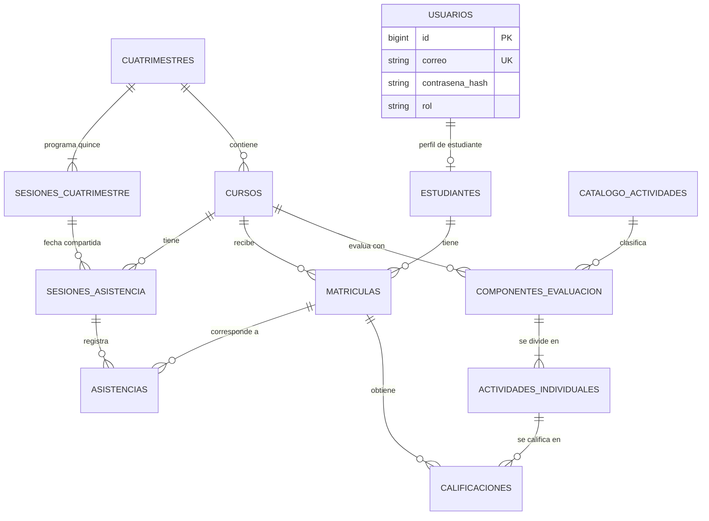

# Diseño y modelo de datos del sistema de notas parciales

## Propósito y alcance

Este documento propone el modelo relacional de MySQL para cumplir [general.md](general.md) y [backend.specs.md](backend.specs.md). Define entidades, claves, relaciones, restricciones y datos derivados. Es una especificación de diseño: no crea tablas ni incluye sentencias SQL.

**Estado:** el calendario automático de quince sesiones y la migración de `3-2026` están implementados. El esquema vigente usa las tablas y relaciones descritas en este documento.

La publicación local del puerto de MySQL para DBeaver es una configuración de Docker y no cambia el modelo de datos: la base de desarrollo se expone solo en `127.0.0.1` mediante `MYSQL_HOST_PORT` (predeterminado `3307`), mientras que la base de pruebas permanece sin puerto publicado.

Las reglas funcionales proceden de las especificaciones citadas. Los nombres de tablas y campos, el uso de identificadores internos y la separación de `usuarios` y `estudiantes` son decisiones de modelado propuestas aquí. Los detalles no confirmados se listan al final.

## Criterios del modelo

- Una sola tabla `usuarios` guarda el correo de acceso y el hash de contraseña. La clave única sobre `correo` impide que profesor y estudiante compartan la misma dirección.
- `estudiantes` guarda únicamente los datos propios del estudiante y referencia a su usuario. La cuenta única del profesor es un registro de `usuarios` con rol `profesor`; se crea con el comando de consola acordado.
- No hay tabla `profesores`: el profesor solo requiere los datos de acceso que ya contiene `usuarios`. Por ejemplo, un registro con `rol = profesor`, `correo = docente@ucatolica.ac.cr` y su hash representa al profesor. La tabla `estudiantes` existe porque cada estudiante sí tiene nombre y dos apellidos adicionales.
- Los cuatrimestres, estudiantes y actividades del catálogo son registros independientes de los cursos y se conservan cuando estos se eliminan.
- Las calificaciones se relacionan con una matrícula y una actividad individual; las asistencias, con una matrícula y una sesión del mismo curso.
- La tabla editable de calificaciones del profesor es una forma de presentación y captura en el frontend. Cada celda sigue usando la relación existente entre `matriculas` y `actividades_individuales` en `calificaciones`; este cambio no requiere tablas, columnas, índices ni migraciones nuevos.
- Los porcentajes, puntajes y notas usan números decimales exactos, no tipos de coma flotante. Solo el porcentaje total se reparte entre actividades y se trunca a dos decimales; el puntaje por actividad se copia íntegro. Los aportes porcentuales también se truncan a dos decimales.
- El resultado del curso, las vistas de concentrado y los archivos `.xlsx` se calculan a partir de los datos vigentes. No requieren tablas de resultados o archivos permanentes.
- El indicador `en_uso` del catálogo se calcula al consultar si la actividad tiene componentes asociados. No requiere columna nueva. La nota y observación que consulta el profesor proceden de `calificaciones`; su ausencia se devuelve como valores nulos sin crear una fila.
- Los JWT y sus claves de firma no se almacenan en estas tablas; la clave se configura mediante una variable de entorno.

## Diagrama de relaciones

`dominios_permitidos` participa en la validación del dominio del correo de `usuarios`. No necesita una clave foránea desde `usuarios`, porque el dominio se obtiene de la dirección de correo y se consulta en esta tabla al crear la cuenta.

## Convenciones de columnas

- Cada tabla operativa usa una clave primaria interna `id`, propuesta como entero autoincremental de 64 bits. `estudiantes` usa `usuario_id` como clave primaria y foránea para mantener una relación uno a uno con `usuarios`.
- Los campos terminados en `_id` son claves foráneas. Todos los textos deben admitir caracteres Unicode.
- Las fechas de cuatrimestre y asistencia son fechas de calendario. El formato visible del cuatrimestre sigue siendo `N-AAAA`.
- Las columnas de nota, porcentaje y puntaje se almacenan como `DECIMAL`. Los valores ingresados para el componente y los asignados a una actividad individual admiten hasta dos decimales.
- El porcentaje total y el puntaje por actividad de un componente admiten hasta dos decimales. Ambos se almacenan como `DECIMAL(5,2)`; los componentes nuevos exigen puntaje por actividad de `1,00` a `100,00`.
- La unicidad de `usuarios.correo` distingue mayúsculas de minúsculas. En cambio, la unicidad de `catalogo_actividades.nombre` no distingue mayúsculas, minúsculas ni tildes. La configuración de comparación de MySQL para cada columna debe respetar su regla correspondiente.
- En la siguiente tabla, **obligatorio** significa que el dato debe existir al crear ese registro; **opcional** permite que aún no se haya registrado.

## Diccionario de tablas

| Tabla | Columnas principales y tipo lógico | Claves y restricciones |
| --- | --- | --- |
| `dominios_permitidos` | `id` entero; `dominio` texto obligatorio. | PK `id`; `dominio` único. Registro inicial: `ucatolica.ac.cr`. Sin módulo CRUD. |
| `usuarios` | `id` entero; `correo` texto obligatorio; `contrasena_hash` texto opcional para estudiante hasta generar su contraseña; `rol` texto obligatorio (`profesor` o `estudiante`). | PK `id`; `correo` único con distinción de mayúsculas y minúsculas. El profesor requiere hash al crearse. Solo puede haber un usuario con rol profesor. |
| `estudiantes` | `usuario_id` entero; `nombre`, `primer_apellido` y `segundo_apellido` textos obligatorios. | PK y FK `usuario_id` → `usuarios.id`. El usuario referido debe tener rol estudiante. |
| `cuatrimestres` | `id` entero; `codigo` texto obligatorio en formato `N-AAAA`; `fecha_inicio` y `fecha_cierre` fechas obligatorias. | PK `id`; `codigo` único; el número `N` está entre 1 y 3; `fecha_cierre` debe ser exactamente 98 días después de `fecha_inicio`. Sus fechas son comunes a todos sus cursos. |
| `sesiones_cuatrimestre` | `id` entero; `cuatrimestre_id` entero; `numero` entero obligatorio; `fecha` fecha obligatoria. | PK `id`; FK `cuatrimestre_id` → `cuatrimestres.id`; únicos (`cuatrimestre_id`, `numero`) y (`cuatrimestre_id`, `fecha`). Exactamente quince filas por cuatrimestre, con `numero` de 1 a 15 y `fecha = fecha_inicio + (numero − 1) × 7 días`. |
| `cursos` | `id` entero; `cuatrimestre_id` entero; `nombre` y `codigo` textos obligatorios; `numero_grupo` entero obligatorio. | PK `id`; FK `cuatrimestre_id` → `cuatrimestres.id`; combinación única (`cuatrimestre_id`, `codigo`, `numero_grupo`). |
| `catalogo_actividades` | `id` entero; `nombre` texto obligatorio. | PK `id`; `nombre` único sin distinguir mayúsculas, minúsculas ni tildes. Una actividad referida por un componente no se puede editar ni eliminar. Los valores iniciales se enumeran más adelante. |
| `componentes_evaluacion` | `id` entero; `curso_id` y `actividad_catalogo_id` enteros; `titulo` texto obligatorio; `cantidad_actividades` entero; `descripcion` texto; `porcentaje_total` y `puntaje_por_actividad` `DECIMAL(5,2)`. | PK `id`; FK a `cursos` y `catalogo_actividades`. Título de máximo 128 palabras; descripción de máximo 256 caracteres; cantidad entre 1 y 15; puntaje por actividad nuevo entre 1 y 100; porcentaje y puntaje con hasta dos decimales; suma de porcentajes del curso ≤ 100 %. La base permite valores positivos inferiores a 1 en filas históricas migradas. |
| `actividades_individuales` | `id` entero; `componente_id` entero; `numero` entero; `porcentaje_asignado` y `puntaje_asignado` decimales de dos cifras. | PK `id`; FK `componente_id` → `componentes_evaluacion.id`; combinación única (`componente_id`, `numero`). Hay exactamente `cantidad_actividades` registros, numerados dentro del componente. |
| `matriculas` | `id` entero; `estudiante_id` y `curso_id` enteros. | PK `id`; FK `estudiante_id` → `estudiantes.usuario_id`; FK `curso_id` → `cursos.id`; combinación única (`estudiante_id`, `curso_id`). |
| `calificaciones` | `id` entero; `matricula_id` y `actividad_individual_id` enteros; `puntos_obtenidos` decimal de dos cifras u opcional mientras no haya nota; `observacion` texto opcional. | PK `id`; FK a `matriculas` y `actividades_individuales`; combinación única (`matricula_id`, `actividad_individual_id`). Observación de máximo 125 caracteres; nota entre 0 y el puntaje asignado. |
| `sesiones_asistencia` | `id` entero; `curso_id` y `sesion_cuatrimestre_id` enteros; `asistencia_registrada` booleano obligatorio, inicialmente `false`. | PK `id`; FK `curso_id` → `cursos.id`; FK `sesion_cuatrimestre_id` → `sesiones_cuatrimestre.id`; único (`curso_id`, `sesion_cuatrimestre_id`). Exactamente quince filas por curso. La fecha se obtiene de `sesiones_cuatrimestre.fecha`, sin columna `fecha` duplicada. La sesión referida debe pertenecer al mismo cuatrimestre que el curso, verificado por el servicio en cada escritura. |
| `asistencias` | `id` entero; `sesion_id` y `matricula_id` enteros; `condicion` texto obligatorio. | PK `id`; FK a `sesiones_asistencia` y `matriculas`; combinación única (`sesion_id`, `matricula_id`). Condición limitada a `presente`, `ausente` o `justificado`. |

El campo `descripcion` admite hasta 256 caracteres y `observacion` hasta 125; si se permite dejar alguno vacío, puede representarse como texto vacío o valor nulo sin cambiar el significado funcional. El título tiene límite de palabras, no de caracteres, por lo que su validación corresponde a la lógica de la aplicación.

## Datos iniciales

- `dominios_permitidos`: un registro con `ucatolica.ac.cr`. Otros dominios se podrán añadir en el futuro sin crear un módulo CRUD en la aplicación.
- `catalogo_actividades`: prueba parcial, proyecto, tarea, trabajo en clase, indagación y exposición, prueba corta y repositorio GitHub. **Indagación y exposición** corresponde a un solo registro.
- La cuenta del único profesor no lleva credenciales predeterminadas en los datos iniciales: el comando de consola recibe su correo y contraseña y almacena el hash.

## Claves, integridad y ciclo de vida

### Identidad y matrícula

- La unicidad de `usuarios.correo` cubre conjuntamente a profesor y estudiantes. Si el correo ya pertenece a un estudiante, la nueva matrícula usa su mismo `usuario_id`; si pertenece al profesor, se rechaza.
- Dos direcciones que solo difieren en mayúsculas y minúsculas se consideran distintas. La comparación usada por el índice único y por el inicio de sesión debe aplicar la misma regla.
- La regla de un único profesor se comprueba al ejecutar el comando de creación de la cuenta. Una restricción única sobre `rol` no serviría porque impediría tener varios estudiantes.
- Antes de insertar un usuario, el backend comprueba que el dominio de su correo exista en `dominios_permitidos`. El dominio inicial permitido es `@ucatolica.ac.cr`.
- La tabla `matriculas` permite varios cursos para un estudiante, pero impide matricularlo dos veces en el mismo curso o grupo.
- Un estudiante y su usuario permanecen aun cuando se elimina su última matrícula.

### Cuatrimestres, cursos y catálogo

- `cuatrimestres.codigo` identifica el período y guarda sus fechas una sola vez. `cursos` referencia ese registro; dos cursos con el mismo código y cuatrimestre se distinguen por `numero_grupo`.
- La creación de un cuatrimestre valida `fecha_cierre = fecha_inicio + 98 días` y, en la misma transacción, inserta exactamente quince filas en `sesiones_cuatrimestre`, numeradas de 1 a 15 cada siete días. Una falla revierte el cuatrimestre y todas sus fechas. La creación de un curso inserta, también atómicamente, exactamente una fila en `sesiones_asistencia` por cada fecha de su cuatrimestre, con `asistencia_registrada = false` y sin filas en `asistencias`.
- Un curso solo se elimina tras la fecha de cierre del cuatrimestre y la confirmación previa del profesor. Al borrarlo desaparecen sus componentes y actividades individuales, matrículas, calificaciones, sesiones y asistencias. Esta operación debe ser atómica para evitar registros huérfanos.
- La eliminación de un curso no elimina su cuatrimestre, estudiantes ni actividades del catálogo. Las relaciones hacia `cuatrimestres`, `estudiantes` y `catalogo_actividades` no deben provocar borrados de esos registros compartidos.
- La eliminación individual de un componente elimina sus actividades individuales y las calificaciones y observaciones ligadas a ellas en una operación atómica. Las claves foráneas de `actividades_individuales.componente_id` y `calificaciones.actividad_individual_id` admiten este borrado en cascada; la lógica de negocio comprueba la confirmación informada antes de iniciarlo. No se eliminan curso, matrículas, estudiantes, sesiones, asistencias, cuatrimestre ni actividad del catálogo. Los resultados y concentrados se recalculan al consultar con las actividades restantes; `en_uso` del catálogo se obtiene de las asociaciones que permanezcan.
- La referencia desde `componentes_evaluacion` impide eliminar una actividad del catálogo en uso. El backend también impide editarla mientras exista esa referencia.
- `catalogo_actividades.nombre` no admite duplicados aunque los nombres solo difieran en mayúsculas, minúsculas o tildes. La base de datos y el backend deben aplicar la misma comparación de nombres. Por ejemplo, `Prueba parcial`, `prueba parcial` y `Prúeba parcial` son duplicados.

### Evaluación

- Al crear un componente se registra la cantidad de actividades individuales y se generan sus filas repartiendo solo `porcentaje_total` por igual. Si esa división produce más de dos decimales, cada `porcentaje_asignado` se trunca sin redistribuir el residuo. Cada `puntaje_asignado` recibe el valor íntegro de `puntaje_por_actividad`, sin dividirlo.
- Una migración renombra la columna histórica `puntaje_total` a `puntaje_por_actividad` y, antes del cambio de nombre, sustituye en cada componente anterior su valor por el `puntaje_asignado` de sus actividades ya creadas. No modifica actividades, calificaciones, observaciones ni resultados derivados. La restricción SQL admite valores mayores que cero y hasta 100 para preservar casos históricos menores que 1; el servicio de creación exige el nuevo mínimo de 1.
- Como corrección puntual posterior a la migración, las siete filas de `actividades_individuales` del componente **Tareas** del curso **Informática Aplicada 1** (`PD008`, grupo `1`, cuatrimestre `3-2026`) tienen `puntaje_asignado = 10,00`, igual al `puntaje_por_actividad` de su componente. Sus `porcentaje_asignado = 2,14` permanecen intactos. Una migración de datos reproducible aplica el ajuste solo si encuentra exactamente ese componente, sus siete puntajes anteriores de `1,42` y ninguna calificación; también acepta que las siete actividades ya tengan `10,00` sin volver a modificarlas. Esta corrección no se aplica a otros componentes históricos.
- El total de los porcentajes de componentes de un mismo curso no supera 100 %. Esta comprobación se realiza al crear el componente.
- Cada calificación combina una matrícula y una actividad individual del **mismo curso**. Las dos claves foráneas, por sí solas, no expresan esta igualdad entre cursos: la operación de escritura debe verificarla antes de guardar.
- La ausencia de fila en `calificaciones`, o una fila sin `puntos_obtenidos`, representa una actividad todavía sin nota. Su aporte al resultado es cero; se distingue de una nota explícita de `0,00`.
- El aporte porcentual se calcula como `(puntos_obtenidos / puntaje_asignado) × porcentaje_asignado`, con cero para una actividad sin nota. Se trunca a dos decimales **antes** de sumar. El resultado del curso es la suma de los aportes truncados y se trunca también a dos decimales. Ninguno de estos valores calculados requiere columna persistida.

### Asistencia

- Una sesión del curso referencia exactamente una fecha programada de su propio cuatrimestre. El número y la fecha se leen de `sesiones_cuatrimestre` y no se editan en `sesiones_asistencia`. No existe alta manual de sesiones de curso.
- `asistencia_registrada = false` significa que el profesor todavía no guardó condiciones para esa sesión; no existen filas de `asistencias` para ella. Sin matrículas no se admite guardar una asistencia vacía. Al primer guardado se insertan las condiciones de todos y solo los matriculados y se marca `true` en la misma transacción. Los guardados posteriores actualizan el conjunto completo. Un error deja intactos el indicador y las condiciones previas.
- Para una sesión registrada debe existir exactamente una condición por matrícula vigente del curso. Cada par sesión-matrícula aparece una sola vez. Al matricular a alguien después de haber registrado asistencia en una o más sesiones, se insertan sus condiciones `justificado` solo en esas sesiones, en la misma transacción que la matrícula. Las sesiones pendientes siguen sin condición, aunque su fecha haya pasado. El profesor puede corregir las condiciones justificadas.
- Cada asistencia une una sesión y una matrícula del **mismo curso**. Esta regla requiere verificación en la operación de escritura, además de las claves foráneas individuales.
- La consulta del estudiante obtiene únicamente sus filas de `asistencias`; una sesión pendiente no se presenta por el solo hecho de estar programada.

### Migración de datos existentes del cuatrimestre `3-2026`

- El registro actual `3-2026` tiene `fecha_inicio = 2026-09-02` y `fecha_cierre = 2026-12-09`: son exactamente 98 días y ambos miércoles. No se cambian las fechas. Se crean los miércoles `2026-09-02`, `09-09`, `09-16`, `09-23`, `09-30`, `10-07`, `10-14`, `10-21`, `10-28`, `11-04`, `11-11`, `11-18`, `11-25`, `12-02` y `12-09`, todos de 2026, numerados del 1 al 15.
- Se respalda la base antes de migrar. Se valida que cada cuatrimestre existente cumpla los 98 días y que cada sesión manual existente coincida con una fecha programada sin duplicados; una incompatibilidad detiene la migración para resolverla sin borrar o modificar asistencias. Se agregan referencias y estado de forma reversible antes de retirar `sesiones_asistencia.fecha`; no se pierde el `id` de sesiones existentes ni sus relaciones con `asistencias`.
- En `PD008`, grupo 1, se conserva la sesión actual `2026-09-02` como sesión 1, con sus diez condiciones y diez matrículas, y se marca registrada; se agregan catorce pendientes. `test-01`, grupo 1, recibe quince pendientes. Una sesión histórica con condiciones completas se marca registrada; una sin condiciones queda pendiente. La verificación posterior comprueba fechas, cantidades, identificadores y condiciones originales antes de finalizar la migración.

## Datos derivados y consultas

La comprobación pública `GET /api/healt` ejecuta una consulta simple (`SELECT 1`) contra la conexión MySQL configurada. No almacena datos, no requiere tablas nuevas y no modifica el esquema.

| Salida | Origen y cálculo | Persistencia |
| --- | --- | --- |
| Porcentaje de una actividad obtenido por un estudiante | `calificaciones.puntos_obtenidos`, `actividades_individuales.puntaje_asignado` y `porcentaje_asignado`; aporte truncado a dos decimales. | No se almacena por separado. |
| Resultado de un curso por estudiante | Suma de los aportes truncados de sus actividades, con resultado final truncado a dos decimales. | No se almacena por separado. |
| Concentrado del profesor por curso y grupo | Matrículas del curso, estudiantes, actividades individuales y calificaciones; muestra nota y porcentaje obtenido. | Se genera al consultar. |
| Concentrado del estudiante por curso | Matrículas propias, actividades y calificaciones; muestra nota y porcentaje obtenido. | Se genera al consultar. |
| Archivo `.xlsx` del profesor | Mismos datos vigentes del concentrado del curso y grupo. | Se genera al descargar; no requiere tabla propia. |

Las observaciones se consultan para las tarjetas del estudiante, aunque no figuran en las tablas de concentrado ni en el `.xlsx`. Las asistencias se consultan por curso y sesión. La base de datos solo aporta los registros del estudiante autenticado a las consultas de ese rol.

## Índices propuestos

- Únicos: `usuarios(correo)` con distinción de mayúsculas y minúsculas, `dominios_permitidos(dominio)`, `cuatrimestres(codigo)`, `cursos(cuatrimestre_id, codigo, numero_grupo)`, `catalogo_actividades(nombre)` sin distinción de mayúsculas, minúsculas ni tildes, `matriculas(estudiante_id, curso_id)`, `actividades_individuales(componente_id, numero)`, `calificaciones(matricula_id, actividad_individual_id)`, `sesiones_cuatrimestre(cuatrimestre_id, numero)`, `sesiones_cuatrimestre(cuatrimestre_id, fecha)`, `sesiones_asistencia(curso_id, sesion_cuatrimestre_id)` y `asistencias(sesion_id, matricula_id)`.
- Para consultas frecuentes: claves foráneas de cursos por cuatrimestre, componentes por curso y actividad del catálogo, matrículas por curso, actividades por componente, sesiones por curso y calificaciones/asistencias por matrícula. Los índices redundantes con los únicos anteriores deben omitirse al concretar las migraciones.
